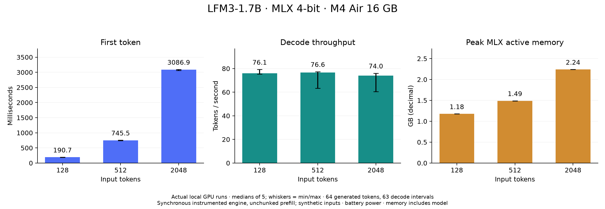
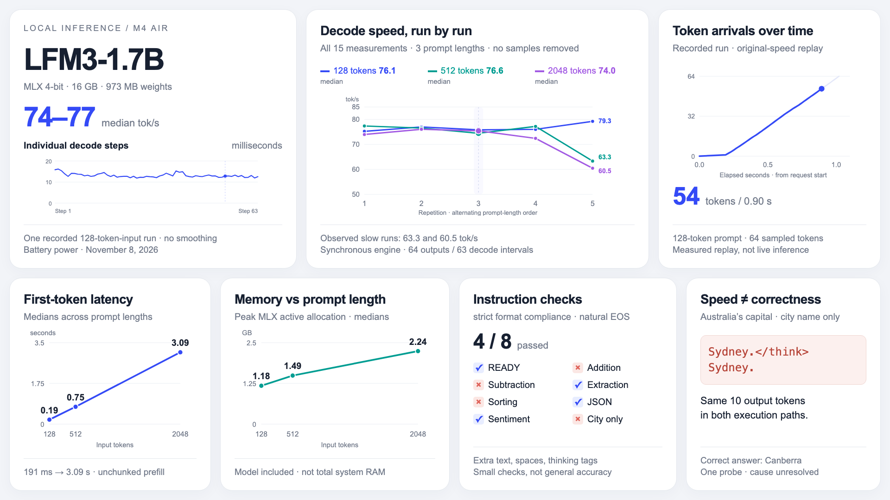

# LFM3-1.7B on a 16 GB M4 MacBook Air

Real local inference measurements using the official MLX 4-bit checkpoint. Measured November 8, 2026, on battery power.

| Input tokens | First token | Decode speed | Peak MLX active allocation |
|---:|---:|---:|---:|
| 128 | 191 ms | 76.1 tok/s | 1.18 GB |
| 512 | 745 ms | 76.6 tok/s | 1.49 GB |
| 2,048 | 3.09 s | 74.0 tok/s | 2.24 GB |

Medians of five measured requests per length. Each synthetic workload generated 64 tokens, with decode throughput measured over 63 incremental intervals. This is a synchronized, unchunked-prefill engine baseline, **not maximum stock-runtime or server throughput**. Memory includes the model; it is not total system RAM.

## Findings and evidence

- [Full findings and limitations](REPORT.md)
- [Raw requests and process logs](runs/)
- [Measurement protocol](protocol.md)
- [Reproduce or independently audit the results](REPRODUCE.md)
- [Independent results audit](evidence/results-audit.json)
- [Animated line-chart video](video/lfm3-bento-v3.mp4) · [editable source](video/)

## Correctness is part of the study

Four of eight strict instruction checks passed. Four failures involved extra text, spaces or thinking markers; this is **not a general accuracy score**. A separate city-only prompt incorrectly returned Sydney as Australia's capital. The direct harness and official generator produced the same ten output token IDs on that probe. The root cause remains unresolved.

## Model and software

Official checkpoint: [LiquidAI/LFM3-1.7B-MLX-4bit](https://huggingface.co/LiquidAI/LFM3-1.7B-MLX-4bit), revision `91f34088d6946482cbcae11b85d4657093618c34`. MLX 0.32.4, MLX-VLM 0.7.12, Python 3.12.13. Full dependency and artifact receipts are in [evidence](evidence/).

Model weights, virtual environments, and dependency binaries are **not redistributed**. The checkpoint retains its upstream license. No broad accuracy evaluation, live-server load test, per-operator GPU trace, or comparison with another model/runtime is claimed.
