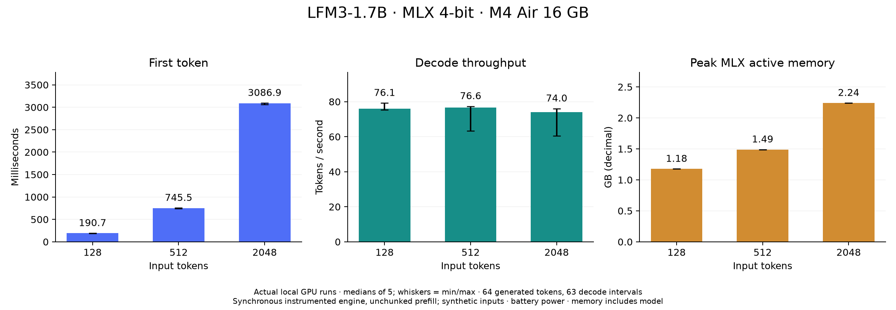

# LFM3-1.7B on M4 Air: real local baseline

Measured November 8, 2026. Actual Apple M4 MacBook Air, 16 GB unified memory, 10 CPU cores, macOS 26.6.2. MLX selected its GPU device and executed the real downloaded checkpoint. No simulated outputs or remote inference were used.

## Findings

The synchronous instrumented MLX engine decoded at approximately **74–77 tokens/s** across the three tested input lengths. Prompt-length growth mostly increased time to first token: **191 ms at 128 tokens**, **745 ms at 512**, and **3,087 ms at 2,048**. Peak MLX active allocations, including the resident model, rose from **1.18 GB to 2.24 GB**. These are baseline measurements for this precise execution path, not maximum stock-runtime or server throughput.

| Input tokens | First token, ms | Decode tokens/s | 64-token engine time, ms | Peak MLX active GB |
|---:|---:|---:|---:|---:|
| 128 | 190.7 | 76.06 | 1,019.9 | 1.177 |
| 512 | 745.5 | 76.57 | 1,573.0 | 1.490 |
| 2,048 | 3,086.9 | 73.99 | 3,931.3 | 2.240 |

Medians of five measured requests per length. All requests generated 64 token IDs, including any special IDs, with EOS stopping disabled for this synthetic workload only. Decode speed uses **63 intervals between the first and last generated tokens**. Warmups are saved but excluded. No samples removed: the slowest decode samples were 63.35 tokens/s at 512 input tokens and 60.48 at 2,048. Five samples do not support p99 claims.

## Real output validation

Eight fixed, natural-EOS instruction probes passed **4/8 strict checks**. This is not a 50% general-accuracy result: several failed responses contain the correct semantic answer but violate the exact output requirement. All eight ended with EOS before the 64-token cap. First and final logits were finite in every measured request; intermediate logits were not individually audited.

| Probe | Exact observed output | Strict result |
|---|---|---|
| READY | `READY` | Pass |
| 17 + 26, integer only | `17 + 26 = 43\n\n43` | Fail: extra explanation |
| 13 − 8, integer only | `13 - 8 = 5\n\n5</think>5` | Fail: extra text/marker |
| Extract tracking code | `AB-204` | Pass |
| Sort, comma-separated without spaces | `1, 2, 3` | Fail: spaces |
| JSON name/age | Valid object with name `Ada`, integer age `27` | Pass |
| Sentiment label | `POSITIVE` | Pass |
| Maya's city only | `Lisbon</think>Lisbon` | Fail: repeated answer/marker |

JSON scoring rejects duplicate keys, floating-point age, extra keys, markdown fences, and trailing content. Thinking was explicitly disabled in the chat template, whose assistant suffix was asserted to be `<think></think>`. Stray closing tags still appeared in generated output; they were not silently stripped to improve scores.

A separate exploratory factual probe asked: `What is the capital of Australia? Reply with only the city name.` It returned **`Sydney.</think>Sydney.`**, which is incorrect. An identical-input comparison between the instrumented direct-forward path and the official `generate_step` path produced the **same ten output token IDs** from the same 26 input IDs. Thus, this probe did not demonstrate a discrepancy between those two paths. It does not establish whether the underlying failure originates in the checkpoint, quantization, or a shared runtime implementation.

An earlier descriptive capital prompt without the city-only instruction produced a correct Canberra answer but reached its 64-token limit. Its different wording means it is not a numerical-parity comparison. Both exploratory outputs remain saved; neither is silently substituted into the eight-case score. No broad model-quality claim follows from this small probe set.

## Model and execution pins

- Repository: [LiquidAI/LFM3-1.7B-MLX-4bit](https://huggingface.co/LiquidAI/LFM3-1.7B-MLX-4bit).
- Revision: `91f34088d6946482cbcae11b85d4657093618c34`.
- Quantization: official 4-bit affine export, group size 64; custom lfm1.0 license.
- Weights: **973,083,386 bytes**. Downloaded 13 repository files totaling **991,131,777 bytes**, excluding only `.gitattributes` from the 14-file repository.
- All downloaded file lengths checked; model and tokenizer SHA256 matched official LFS metadata. Local hashes saved for every downloaded file.
- Python **3.12.13**, MLX **0.32.4**, MLX-VLM **0.7.12**; complete package versions in `evidence/requirements-freeze.txt`.
- Harness SHA256: `aa0327f81beaa8a38669f85eaf62b9974270753ccd1cebe613a0d27e2078bdd4`.

An isolated virtual environment was installed; no global Python packages were changed. GPU availability, actual default device, and Apple M4 device metadata were recorded. This study did not capture a per-operator Metal trace, so it does not claim an audited inventory of every kernel's placement.

## What the timings measure

The harness calls the official model's language-model forward implementation with a fresh recurrent/KV cache for every request. It uses argmax with no repetition penalty, no speculative decoding, no prefix reuse, and unchunked prompt prefill. Inputs are exact-length synthetic repeated ordinary token IDs inside a real thinking-disabled chat envelope. They are performance microbenchmarks, not realistic conversational-quality examples.

Each step evaluates the selected token and cache states, synchronizes MLX, then records completion. The first output is generated by prefill; the remaining 63 outputs use incremental decode. The timer includes host-loop and synchronization overhead. It excludes prompt construction, tokenization, cache creation, and final text decoding. First-token latency includes the final logits and argmax work, so it is not labeled pure prefill time. A separately saved request metric includes detokenization and finite checks but still excludes preparation.

The stock iterator computes ahead, so its streaming boundaries were not reused as if they matched this synchronous definition. The direct path was validated against the official generator on the identical-input factual probe. That is targeted parity evidence, not exhaustive equivalence across all contexts. Unchunked prefill can allocate more work/memory than the runtime's optimized chunked route; these measurements must not be represented as the best performance MLX-VLM can achieve.

Peak memory uses MLX's reset/read active-allocation accounting, including the model and request. It is not whole-process RSS, total system memory, or an extra pool to add to unified memory. No per-token memory trace was recorded.

## Process-cold loads and operating conditions

Three fresh processes loaded the model in **1,335.1 ms**, **514.7 ms**, and **487.9 ms**; median **514.7 ms**. Externally timed whole processes took **4.610 s**, **1.415 s**, and **1.345 s**, including imports, model load, a READY request, and process shutdown. These are process-cold probes, not disk-cold or virgin-install loads: filesystem, driver, and shader caches were uncontrolled. Initial exploratory CLI outputs were preserved separately and were not treated as comparable load-timing samples.

The machine was on battery throughout the recorded before/after observations: **29% before setup** and **25% after the campaign**. This change includes installation and downloads, not just inference; it is not an energy-per-request measurement. `pmset` reported no recorded thermal/performance warning at the two snapshots, but continuous thermal monitoring was not performed. Background OS activity and sustained thermal behavior were not controlled. Prompt-length order alternated across repetitions, and no agent ran concurrent model inference during timing.

## Verification and artifacts

The independent reviewer checked **15 measured requests, 3 warmups, 8 functional probes, 3 fresh-process probes, and four successful process receipts**. Raw token lengths, 63-interval denominators, timestamps, finite flags, GPU selection, scoring, and harness hashes passed. All **12 reported medians and 24 extrema** matched independent recomputation from raw JSONL.

- `runs/`: original campaign, cold and exploratory JSONL, logs, external process receipts.
- `summary.json`: full derived results with raw functional outputs.
- `protocol.md`: measurement and scoring rules.
- `harness.py`, `run_campaign.py`, `summarize.py`, `plot_results.py`: reproduction scripts.
- `evidence/download-manifest.json`: exact file identities and hashes.
- `evidence/parity-check.json`: same-input official/direct token comparison.
- `evidence/results-audit.json`, `evidence/harness-review.md`: independent checks.
- `performance.png`, `performance.svg`: chart with medians and full observed ranges.

No GitHub publication, video, CPU comparison, alternative quantization run, load/concurrency sweep, or general accuracy benchmark was performed. The measured baseline and narrow output failures are complete; the root cause of those failures remains unresolved.
